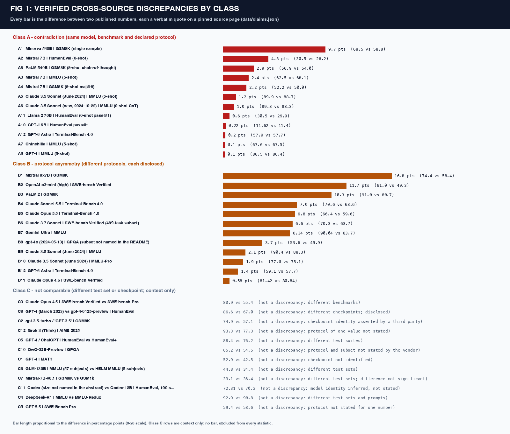
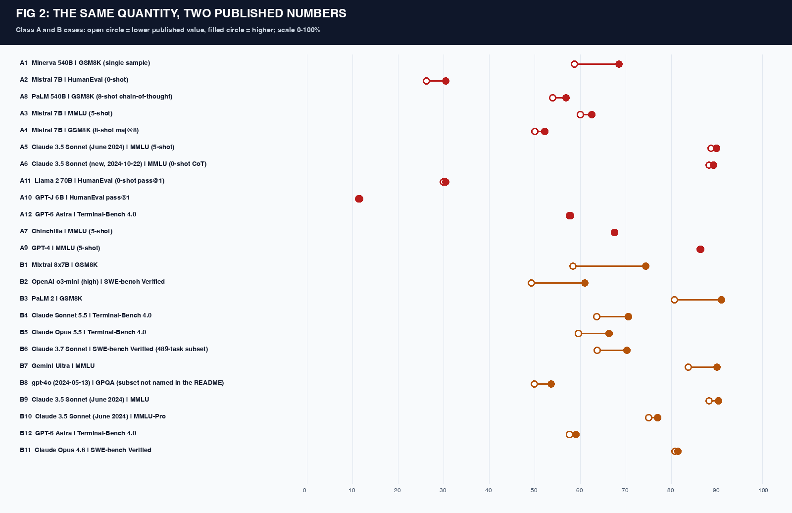
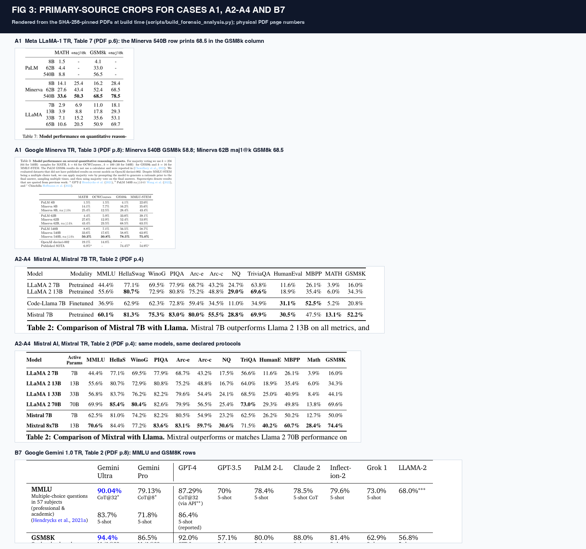
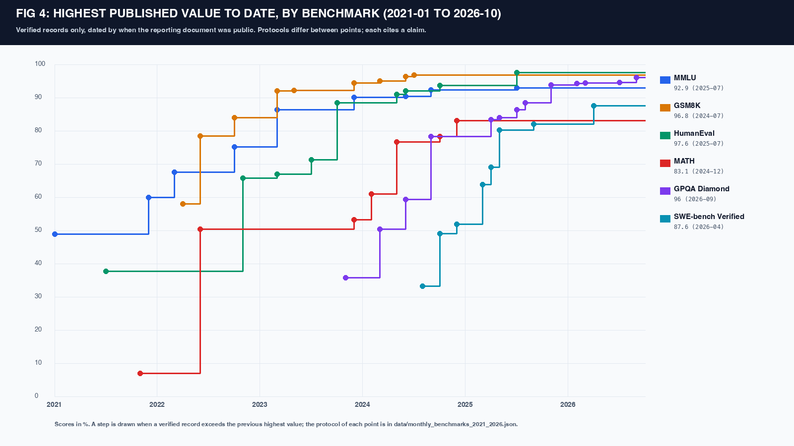

# Seriously, Models? A Source-Verified Audit of Frontier LLM Benchmark Reporting (2021-2026)

Every number in this repository is a verbatim quote on a specific page of a SHA-256-pinned primary source (190 documents: arXiv papers by version, vendor pages and system cards by Wayback Machine capture, GitHub files by commit). 1,083 claims are checked mechanically on every build; a number that cannot be found on its cited page is not published.

## Findings

1. **12 contradictions (class A):** the same model, benchmark and declared protocol carry different published numbers. Median difference 1.1 points, range 0.1 to 9.7. They include a transcription error in a competitor's table, a vendor publishing different numbers for its own model in two papers under identical protocol text, competitors reporting a rival higher or lower than the rival itself, and text that disagrees with the table next to it.
2. **12 protocol asymmetries (class B):** the same model and benchmark under different disclosed protocols. Median difference 6.47 points, range 0.58 to 16.0. The protocol a headline chooses (consensus voting, parallel sampling, a modified prompt, a different scaffold or checkpoint under the same label) moves the reported number by several points.
3. **12 pairs are not comparable (class C)** and are shown only as context: different benchmarks or test sets, unestablished checkpoint identity, or an unstated protocol. No statistic pools classes.

| Case | Class | Model | Benchmark | Published values | Difference (pts) |
| :---: | :---: | :--- | :--- | :--- | :---: |
| [A1](DISCREPANCY_AUDIT.md#a1) | A | Minerva 540B | GSM8K (single sample) | 68.5 (Meta (LLaMA-1 TR, Table 7)) vs 58.8 (Google (Minerva TR, Table 3)) | 9.7 |
| [A2](DISCREPANCY_AUDIT.md#a2) | A | Mistral 7B | HumanEval (0-shot) | 30.5 (Mistral AI (Mistral 7B TR, Table 2)) vs 26.2 (Mistral AI (Mixtral TR, Table 2)) | 4.3 |
| [A3](DISCREPANCY_AUDIT.md#a3) | A | Mistral 7B | MMLU (5-shot) | 62.5 (Mistral AI (Mixtral TR, Table 2)) vs 60.1 (Mistral AI (Mistral 7B TR, Table 2)) | 2.4 |
| [A4](DISCREPANCY_AUDIT.md#a4) | A | Mistral 7B | GSM8K (8-shot maj@8) | 52.2 (Mistral AI (Mistral 7B TR, Table 2)) vs 50.0 (Mistral AI (Mixtral TR, Table 2)) | 2.2 |
| [A5](DISCREPANCY_AUDIT.md#a5) | A | Claude 3.5 Sonnet (June 2024) | MMLU (5-shot) | 89.9 (Meta (Llama 3 Herd TR, Table 2)) vs 88.7 (Anthropic (Claude 3.5 Sonnet model card addendum, Table 1)) | 1.2 |
| [A6](DISCREPANCY_AUDIT.md#a6) | A | Claude 3.5 Sonnet (new, 2024-10-22) | MMLU (0-shot CoT) | 89.3 (Anthropic (October 2024 addendum, Table 7)) vs 88.3 (DeepSeek (DeepSeek-R1 TR v1, Table 4)) | 1.0 |
| [A7](DISCREPANCY_AUDIT.md#a7) | A | Chinchilla | MMLU (5-shot) | 67.6 (DeepMind (Chinchilla TR, Table 6 and Section 4.2.2)) vs 67.5 (DeepMind (Chinchilla TR, abstract)) | 0.1 |
| [A8](DISCREPANCY_AUDIT.md#a8) | A | PaLM 540B | GSM8K (8-shot chain-of-thought) | 56.9 (Wei et al. (Google), arXiv:2201.11903v6 Table 1) vs 54.0 (Chowdhery et al. (Google), arXiv:2204.02311v5 Table 10) | 2.9 |
| [A9](DISCREPANCY_AUDIT.md#a9) | A | GPT-4 | MMLU (5-shot) | 86.5 (TII (Falcon series paper, Table 19), quoting GPT-4 paper) vs 86.4 (OpenAI (GPT-4 Technical Report)) | 0.1 |
| [A10](DISCREPANCY_AUDIT.md#a10) | A | GPT-J 6B | HumanEval pass@1 | 11.62 (Chen et al. (Codex paper), Table 1) vs 11.4 (Chen et al. (Codex paper), abstract) | 0.22 |
| [A11](DISCREPANCY_AUDIT.md#a11) | A | Llama 2 70B | HumanEval (0-shot pass@1) | 30.5 (Meta (Code Llama paper, v3)) vs 29.9 (Meta (Touvron et al. 2023b, Table 4)) | 0.6 |
| [A12](DISCREPANCY_AUDIT.md#a12) | A | GPT-6 Astra | Terminal-Bench 4.0 | 57.9 (OpenAI, GPT-6 Astra launch post (Wayback capture 2026-09-03)) vs 57.7 (OpenAI, GPT-6 Astra launch post (Wayback capture 2026-09-03)) | 0.2 |
| [B1](DISCREPANCY_AUDIT.md#b1) | B | Mixtral 8x7B | GSM8K | 74.4 (Mistral AI (Mixtral TR, Table 2)) vs 58.4 (Mistral AI (Mixtral TR, Table 3)) | 16.0 |
| [B2](DISCREPANCY_AUDIT.md#b2) | B | OpenAI o3-mini (high) | SWE-bench Verified | 61.0 (OpenAI (GPT-4.5 launch post, Feb 27 2025)) vs 49.3 (OpenAI (GPT-4.1 launch post, Apr 14 2025, appendix)) | 11.7 |
| [B3](DISCREPANCY_AUDIT.md#b3) | B | PaLM 2 | GSM8K | 91.0 (Google (PaLM 2 TR, Table 7)) vs 80.7 (Google (PaLM 2 TR, Table 7)) | 10.3 |
| [B4](DISCREPANCY_AUDIT.md#b4) | B | Claude Sonnet 5.5 | Terminal-Bench 4.0 | 70.6 (Anthropic (Claude Sonnet 5.5 page)) vs 63.6 (Artificial Analysis (model page, capture 2026-10-16)) | 7.0 |
| [B5](DISCREPANCY_AUDIT.md#b5) | B | Claude Opus 5.5 | Terminal-Bench 4.0 | 66.4 (Anthropic (Claude Opus 5.5 page)) vs 59.6 (Artificial Analysis (model page, capture 2026-10-18)) | 6.8 |
| [B6](DISCREPANCY_AUDIT.md#b6) | B | Claude 3.7 Sonnet | SWE-bench Verified (489-task subset) | 70.3 (Anthropic (Claude 3.7 Sonnet launch post)) vs 63.7 (Anthropic (Claude 3.7 Sonnet launch post)) | 6.6 |
| [B7](DISCREPANCY_AUDIT.md#b7) | B | Gemini Ultra | MMLU | 90.04 (Google (Gemini 1.0 TR, Table 2)) vs 83.7 (Google (Gemini 1.0 TR, Table 2)) | 6.34 |
| [B8](DISCREPANCY_AUDIT.md#b8) | B | gpt-4o (2024-05-13) | GPQA (subset not named in the README) | 53.6 (OpenAI (simple-evals README, commit 294cb1f, 2024-05-13)) vs 49.9 (OpenAI (simple-evals README, commit 294cb1f, 2024-05-13)) | 3.7 |
| [B9](DISCREPANCY_AUDIT.md#b9) | B | Claude 3.5 Sonnet (June 2024) | MMLU | 90.4 (Anthropic (Claude 3.5 Sonnet model card addendum, Table 1)) vs 88.3 (Anthropic (Claude 3.5 Sonnet model card addendum, Table 1)) | 2.1 |
| [B10](DISCREPANCY_AUDIT.md#b10) | B | Claude 3.5 Sonnet (June 2024) | MMLU-Pro | 77.0 (Meta (Llama 3 Herd of Models, Table 2)) vs 75.1 (Anthropic (Claude 3.5 Sonnet (New) & Haiku addendum, Oct 2024, Table 7)) | 1.9 |
| [B11](DISCREPANCY_AUDIT.md#b11) | B | Claude Opus 4.6 | SWE-bench Verified | 81.42 (Anthropic, Introducing Claude Opus 4.6) vs 80.84 (Anthropic, Claude Opus 4.6 System Card (Feb 2026)) | 0.58 |
| [B12](DISCREPANCY_AUDIT.md#b12) | B | GPT-6 Astra | Terminal-Bench 4.0 | 59.1 (Artificial Analysis model page (Wayback)) vs 57.7 (OpenAI, GPT-6 Astra launch post (Wayback capture 2026-09-03)) | 1.4 |







## Month-by-month dataset

718 verified scores for 229 model names across 70 months (January 2021 to October 2026; 64 months contain at least one verified score). Each score cites its claim. Figure 4 tracks, per benchmark, the highest value published by each month, dated by when the reporting document was public (the first arXiv version when the number is already in it). Protocols differ between points; oracle metrics such as pass@100 are excluded.



| Month | Verified scores | Models | MMLU | MMLU-Pro | HumanEval | GSM8K | MATH | MATH-500 |
| :---: | :---: | :--- | :---: | :---: | :---: | :---: | :---: | :---: |
| [2021-01](BENCHMARKS_MONTH_BY_MONTH.md#2021-01) | 4 | GPT-3 X-Large (few-shot) [davinci, 175B], UnifiedQA (11B, T5 backbone), davinci (175B) | 48.9 |  |  |  |  |  |
| [2021-02](BENCHMARKS_MONTH_BY_MONTH.md#2021-02) | 0 |  | 48.9 |  |  |  |  |  |
| [2021-03](BENCHMARKS_MONTH_BY_MONTH.md#2021-03) | 5 | GPT-2 1.5B (AMPS-pretrained, MATH fine-tuned), GPT-3 175B* (few-shot), GPT-Neo 1.3B, GPT-Neo 2.7B | 48.9 |  |  |  |  |  |
| [2021-04](BENCHMARKS_MONTH_BY_MONTH.md#2021-04) | 0 |  | 48.9 |  |  |  |  |  |
| [2021-05](BENCHMARKS_MONTH_BY_MONTH.md#2021-05) | 0 |  | 48.9 |  |  |  |  |  |
| [2021-06](BENCHMARKS_MONTH_BY_MONTH.md#2021-06) | 3 | GPT-J (6B), GPT-J 6B | 48.9 |  |  |  |  |  |
| [2021-07](BENCHMARKS_MONTH_BY_MONTH.md#2021-07) | 5 | Codex-12B, Codex-S, GPT-3 (size not stated) | 48.9 |  | 37.7 |  |  |  |
| [2021-08](BENCHMARKS_MONTH_BY_MONTH.md#2021-08) | 2 | J1-Jumbo v1 (178B) | 48.9 |  | 37.7 |  |  |  |
| [2021-09](BENCHMARKS_MONTH_BY_MONTH.md#2021-09) | 0 |  | 48.9 |  | 37.7 |  |  |  |
| [2021-10](BENCHMARKS_MONTH_BY_MONTH.md#2021-10) | 4 | GPT-3 175B finetuned plus an additional 175B verifier, GPT-3 175B finetuned with 7.5k examples, TNLG v2 (530B) | 48.9 |  | 37.7 |  |  |  |
| [2021-11](BENCHMARKS_MONTH_BY_MONTH.md#2021-11) | 0 |  | 48.9 |  | 37.7 |  | 6.9 |  |
| [2021-12](BENCHMARKS_MONTH_BY_MONTH.md#2021-12) | 2 | Gopher (280B), Gopher (5-shot) 280B | 60.0 |  | 37.7 |  | 6.9 |  |
| [2022-01](BENCHMARKS_MONTH_BY_MONTH.md#2022-01) | 15 | code-davinci-002, text-davinci-002 | 60.0 |  | 37.7 |  | 6.9 |  |
| [2022-02](BENCHMARKS_MONTH_BY_MONTH.md#2022-02) | 3 | GPT-NeoX-20B | 60.0 |  | 37.7 |  | 6.9 |  |
| [2022-03](BENCHMARKS_MONTH_BY_MONTH.md#2022-03) | 5 | Chinchilla 70B, code-davinci-002 | 67.6 |  | 37.7 |  | 6.9 |  |
| [2022-04](BENCHMARKS_MONTH_BY_MONTH.md#2022-04) | 15 | Anthropic-LM v4-s3 (52B), PaLM 540B, PaLM-Coder 540B, code-davinci-001 (Davinci Codex) | 67.6 |  | 37.7 | 58.0 | 6.9 |  |
| [2022-05](BENCHMARKS_MONTH_BY_MONTH.md#2022-05) | 4 | OPT-175B | 67.6 |  | 37.7 | 58.0 | 6.9 |  |
| [2022-06](BENCHMARKS_MONTH_BY_MONTH.md#2022-06) | 8 | Minerva 540B, Minerva 62B, OpenAI davinci-002 (variant unstated) | 67.6 |  | 37.7 | 78.5 | 50.3 |  |
| [2022-07](BENCHMARKS_MONTH_BY_MONTH.md#2022-07) | 4 | BLOOM 176B | 67.6 |  | 37.7 | 78.5 | 50.3 |  |
| [2022-08](BENCHMARKS_MONTH_BY_MONTH.md#2022-08) | 3 | GLM-130B | 67.6 |  | 37.7 | 78.5 | 50.3 |  |
| [2022-09](BENCHMARKS_MONTH_BY_MONTH.md#2022-09) | 1 | code-davinci-002 + CodeT | 67.6 |  | 37.7 | 78.5 | 50.3 |  |
| [2022-10](BENCHMARKS_MONTH_BY_MONTH.md#2022-10) | 4 | Flan-PaLM 540B | 75.2 |  | 37.7 | 83.9 | 50.3 |  |
| [2022-11](BENCHMARKS_MONTH_BY_MONTH.md#2022-11) | 11 | GPT-3.5, GPT-3.5 (snapshot not named), Galactica 120B, gpt-3.5-turbo and 1 more | 75.2 |  | 65.8 | 83.9 | 50.3 |  |
| [2022-12](BENCHMARKS_MONTH_BY_MONTH.md#2022-12) | 2 | OPT-IML-Max 175B | 75.2 |  | 65.8 | 83.9 | 50.3 |  |
| [2023-01](BENCHMARKS_MONTH_BY_MONTH.md#2023-01) | 1 | SantaCoder 1.1B (final) | 75.2 |  | 65.8 | 83.9 | 50.3 |  |
| [2023-02](BENCHMARKS_MONTH_BY_MONTH.md#2023-02) | 8 | LLaMA 65B, LLaMA-I 65B | 75.2 |  | 65.8 | 83.9 | 50.3 |  |
| [2023-03](BENCHMARKS_MONTH_BY_MONTH.md#2023-03) | 3 | GPT-4 | 86.4 |  | 67.0 | 92.0 | 50.3 |  |
| [2023-04](BENCHMARKS_MONTH_BY_MONTH.md#2023-04) | 0 |  | 86.4 |  | 67.0 | 92.0 | 50.3 |  |
| [2023-05](BENCHMARKS_MONTH_BY_MONTH.md#2023-05) | 12 | Flan-PaLM 2, Flan-PaLM 2 (L), GPT-4, PaLM 2 and 3 more | 86.4 |  | 67.0 | 92.2 | 50.3 |  |
| [2023-06](BENCHMARKS_MONTH_BY_MONTH.md#2023-06) | 4 | StarCoder 15B, Vicuna 13B, WizardCoder 15B | 86.4 |  | 67.0 | 92.2 | 50.3 |  |
| [2023-07](BENCHMARKS_MONTH_BY_MONTH.md#2023-07) | 19 | Claude 1.3, Claude 2, Claude Instant, Llama 2 13B and 2 more | 86.4 |  | 71.2 | 92.2 | 50.3 |  |
| [2023-08](BENCHMARKS_MONTH_BY_MONTH.md#2023-08) | 4 | Code Llama - Instruct 34B, Code Llama - Python 34B, Code Llama 34B, Llama 2 70B | 86.4 |  | 71.2 | 92.2 | 50.3 |  |
| [2023-09](BENCHMARKS_MONTH_BY_MONTH.md#2023-09) | 6 | LLaMA 2 13B, Mistral 7B | 86.4 |  | 71.2 | 92.2 | 50.3 |  |
| [2023-10](BENCHMARKS_MONTH_BY_MONTH.md#2023-10) | 6 | LLEMMA 34B | 86.4 |  | 88.4 | 92.2 | 50.3 |  |
| [2023-11](BENCHMARKS_MONTH_BY_MONTH.md#2023-11) | 12 | Falcon-180B, GPT-4, Grok-1, Qwen-72B (base) | 86.4 |  | 88.4 | 92.2 | 50.3 |  |
| [2023-12](BENCHMARKS_MONTH_BY_MONTH.md#2023-12) | 38 | GPT-4, GPT-4 (gpt-4-0613), Gemini Ultra, Gemini Ultra (post-trained API model) and 7 more | 90.04 |  | 88.4 | 94.4 | 53.2 |  |
| [2024-01](BENCHMARKS_MONTH_BY_MONTH.md#2024-01) | 19 | Code Llama - Instruct 70B, DeepSeek 67B (Base), DeepSeek 67B Chat, DeepSeek-Coder-Instruct 33B and 2 more | 90.04 |  | 88.4 | 94.4 | 53.2 |  |
| [2024-02](BENCHMARKS_MONTH_BY_MONTH.md#2024-02) | 13 | DeepSeekMath 7B (variant not named in the sentence), DeepSeekMath-RL 7B, Gemini 1.5 Pro, Gemini 1.5 Pro (Feb 2024) and 1 more | 90.04 |  | 88.4 | 94.4 | 60.9 |  |
| [2024-03](BENCHMARKS_MONTH_BY_MONTH.md#2024-03) | 13 | Claude 3 Opus, GPT-4, Grok-1.5 | 90.04 |  | 88.4 | 95.0 | 60.9 |  |
| [2024-04](BENCHMARKS_MONTH_BY_MONTH.md#2024-04) | 19 | Llama 3 70B (instruction tuned), Mixtral 8x22B (instructed), Mixtral 8x22B Inst., Phi-3-small 7b and 1 more | 90.04 |  | 88.4 | 95.0 | 60.9 |  |
| [2024-05](BENCHMARKS_MONTH_BY_MONTH.md#2024-05) | 36 | DeepSeek-V2 Chat (RL), GPT-4o, GPT-4o 0513, Gemini 1.5 Pro (May 2024) and 2 more | 90.04 |  | 91.0 | 95.0 | 76.6 |  |
| [2024-06](BENCHMARKS_MONTH_BY_MONTH.md#2024-06) | 25 | Claude 3.5 Sonnet, DS-Coder-V2-Instruct, Qwen2-72B (base), Qwen2-72B-Instruct | 90.4 |  | 92.0 | 96.4 | 76.6 |  |
| [2024-07](BENCHMARKS_MONTH_BY_MONTH.md#2024-07) | 18 | GPT4o-mini, LLaMA-3.1 405B-Inst., Llama 3 405B (Llama 3.1 405B Instruct), Llama 3 405B (pre-trained) and 3 more | 90.4 | 77.0 | 92.0 | 96.8 | 76.6 |  |
| [2024-08](BENCHMARKS_MONTH_BY_MONTH.md#2024-08) | 11 | GPT-4o (checkpoint not stated), Grok-2, Phi-3.5-MoE 16x3.8B, gpt-4o-2024-08-06 | 90.4 | 77.0 | 92.0 | 96.8 | 76.6 |  |
| [2024-09](BENCHMARKS_MONTH_BY_MONTH.md#2024-09) | 33 | DeepSeek V2.5-0905, Gemini 1.5 Pro (September 2024 release), OpenAI-o1-mini, Qwen2.5-72B (base) and 4 more | 92.3 | 77.0 | 92.0 | 96.8 | 76.6 | 94.8 |
| [2024-10](BENCHMARKS_MONTH_BY_MONTH.md#2024-10) | 23 | Claude 3.5 Haiku, Claude 3.5 Sonnet (New), Claude-3.5-Sonnet-1022 | 92.3 | 78.0 | 93.7 | 96.8 | 78.3 | 94.8 |
| [2024-11](BENCHMARKS_MONTH_BY_MONTH.md#2024-11) | 9 | Marco-o1-MCTS (step), QwQ-32B-Preview | 92.3 | 78.0 | 93.7 | 96.8 | 78.3 | 94.8 |
| [2024-12](BENCHMARKS_MONTH_BY_MONTH.md#2024-12) | 26 | DeepSeek-V3, DeepSeek-V3 Base, Gemini 2.0 Flash (research coding agent), Llama-3.3 70B Instruct and 4 more | 92.3 | 78.0 | 93.7 | 96.8 | 83.1 | 94.8 |
| [2025-01](BENCHMARKS_MONTH_BY_MONTH.md#2025-01) | 19 | DeepSeek-R1, Kimi k1.5 (long-CoT), OpenAI o3-mini (high), o3-mini (tools), non-final checkpoint and 2 more | 92.3 | 84.0 | 93.7 | 96.8 | 83.1 | 97.3 |
| [2025-02](BENCHMARKS_MONTH_BY_MONTH.md#2025-02) | 18 | Claude 3.7 Sonnet, GPT-4.5, Grok 3 (Think), Grok 3 (Think) [chart code GROK_3_R] and 2 more | 92.3 | 84.0 | 93.7 | 96.8 | 83.1 | 97.3 |
| [2025-03](BENCHMARKS_MONTH_BY_MONTH.md#2025-03) | 13 | DeepSeek-V3-0324, Gemini 2.5 Pro (Experimental 03-25), Gemini2.5-Pro, QwQ-32B | 92.3 | 84.0 | 93.7 | 96.8 | 83.1 | 97.3 |
| [2025-04](BENCHMARKS_MONTH_BY_MONTH.md#2025-04) | 25 | GPT-4.1, Llama 4 Maverick (instruction tuned), OpenAI o3 (high), Qwen3-235B-A22B (Non-thinking) and 8 more | 92.3 | 84.0 | 93.7 | 96.8 | 83.1 | 97.3 |
| [2025-05](BENCHMARKS_MONTH_BY_MONTH.md#2025-05) | 19 | Claude Opus 4, Claude Sonnet 4, DeepSeek-R1-0528, Vicuna-13b and 1 more | 92.3 | 85.0 | 93.7 | 96.8 | 83.1 | 98.0 |
| [2025-06](BENCHMARKS_MONTH_BY_MONTH.md#2025-06) | 12 | Gemini 2.5 Pro, Magistral Medium, MiniMax-M1-80k | 92.3 | 85.0 | 93.7 | 96.8 | 83.1 | 98.0 |
| [2025-07](BENCHMARKS_MONTH_BY_MONTH.md#2025-07) | 17 | GLM-4.5, Grok 4, Grok 4 (no tools) [chart code GROK_4_NT], Grok 4 Heavy [chart code GROK_4_HEAVY] and 2 more | 92.9 | 85.0 | 97.6 | 96.8 | 83.1 | 98.0 |
| [2025-08](BENCHMARKS_MONTH_BY_MONTH.md#2025-08) | 13 | Claude Opus 4.1, DeepSeek V3.1-NonThinking, DeepSeek V3.1-Thinking, GPT-5 (thinking) and 4 more | 92.9 | 86.6 | 97.6 | 96.8 | 83.1 | 98.2 |
| [2025-09](BENCHMARKS_MONTH_BY_MONTH.md#2025-09) | 12 | Claude Sonnet 4.5, Claude Sonnet 4.5 (Thinking), DeepSeek-V3.2-Exp, GLM-4.6 | 92.9 | 86.6 | 97.6 | 96.8 | 83.1 | 98.2 |
| [2025-10](BENCHMARKS_MONTH_BY_MONTH.md#2025-10) | 1 | Claude Haiku 4.5 | 92.9 | 86.6 | 97.6 | 96.8 | 83.1 | 98.2 |
| [2025-11](BENCHMARKS_MONTH_BY_MONTH.md#2025-11) | 19 | Claude Opus 4.5, GPT-5.1 Thinking, Gemini 3 Deep Think, Gemini 3 Pro and 2 more | 92.9 | 86.6 | 97.6 | 96.8 | 83.1 | 98.2 |
| [2025-12](BENCHMARKS_MONTH_BY_MONTH.md#2025-12) | 21 | DeepSeek-V3.2 Thinking, DeepSeek-V3.2-Speciale, GLM-4.7, GPT-5.2 Pro and 2 more | 92.9 | 90.1 | 97.6 | 96.8 | 83.1 | 98.2 |
| [2026-01](BENCHMARKS_MONTH_BY_MONTH.md#2026-01) | 6 | Kimi K2.5 | 92.9 | 90.1 | 97.6 | 96.8 | 83.1 | 98.2 |
| [2026-02](BENCHMARKS_MONTH_BY_MONTH.md#2026-02) | 23 | Claude Opus 4.6, Claude Sonnet 4.6, GLM-5, GPT-5.3-Codex (xhigh) and 2 more | 92.9 | 90.1 | 97.6 | 96.8 | 83.1 | 98.2 |
| [2026-03](BENCHMARKS_MONTH_BY_MONTH.md#2026-03) | 5 | GPT-5.4, GPT-5.4 Pro | 92.9 | 90.1 | 97.6 | 96.8 | 83.1 | 98.2 |
| [2026-04](BENCHMARKS_MONTH_BY_MONTH.md#2026-04) | 12 | Claude Opus 4.7, DeepSeek-V4-Pro (Think Max), GPT-5.5 | 92.9 | 90.1 | 97.6 | 96.8 | 83.1 | 98.2 |
| [2026-05](BENCHMARKS_MONTH_BY_MONTH.md#2026-05) | 2 | Gemini 3.5 Flash | 92.9 | 90.1 | 97.6 | 96.8 | 83.1 | 98.2 |
| [2026-06](BENCHMARKS_MONTH_BY_MONTH.md#2026-06) | 5 | Claude Sonnet 5, GLM-5.2 | 92.9 | 90.1 | 97.6 | 96.8 | 83.1 | 98.2 |
| [2026-07](BENCHMARKS_MONTH_BY_MONTH.md#2026-07) | 5 | GPT-5.6 Sol, Grok 4.5 | 92.9 | 90.1 | 97.6 | 96.8 | 83.1 | 98.2 |
| [2026-08](BENCHMARKS_MONTH_BY_MONTH.md#2026-08) | 3 | Qwen3.8-Max | 92.9 | 90.1 | 97.6 | 96.8 | 83.1 | 98.2 |
| [2026-09](BENCHMARKS_MONTH_BY_MONTH.md#2026-09) | 8 | Claude Opus 5.5, Claude Opus 5.5 (Artificial Analysis run: Claude Opus 5.5 (Max, Default Fallback)), Claude Sonnet 5.5, Claude Sonnet 5.5 (Artificial Analysis run: Claude Sonnet 5.5 (max with fallback)) and 1 more | 92.9 | 90.1 | 97.6 | 96.8 | 83.1 | 98.2 |
| [2026-10](BENCHMARKS_MONTH_BY_MONTH.md#2026-10) | 2 | Claude Haiku 5.5, Gemini 4 Argon | 92.9 | 90.1 | 97.6 | 96.8 | 83.1 | 98.2 |

## Method and verification

```bash
python3 scripts/download_sources.py         # fetch and pin every source; refuses changed bytes
python3 scripts/evidence.py                 # verify every claim against its pinned page
python3 scripts/build_forensic_analysis.py  # build the case catalog and figures 1-3
python3 scripts/build_dataset.py            # build the month-by-month dataset
python3 scripts/generate_charts.py          # figure 4
python3 scripts/extract_original_figures.py # references to the cited source pages
python3 scripts/build_docs_and_pdf.py       # this README, the audit, the dossier and the PDF
python3 scripts/adversarial_verify.py       # all gates plus break tests
python3 -m unittest discover -s tests       # verifier unit and break tests
```

Requirements: Python 3, Pillow, poppler (pdftotext, pdftoppm, pdfinfo), curl; pandoc and mutool for the PDF.

## Limitations

1. Mechanical verification proves that a quoted string occurs on the cited page and that the value sits in the stated column. It does not prove that the model label in the claim is the one the source means; that attribution was made by reading the source, and column order was checked on rendered pages where text extraction is ambiguous.
2. A source can be internally inconsistent. Example: the o3-mini launch post's image alt text gives 48.9 for o3-mini (high), while the chart itself shows 49.3 for o3-mini (high) and 48.9 for o1. Such cases are documented when found; the method does not detect them automatically.
3. Numbers that appear only inside images are not used, except where stated as visual checks.
4. Vendor web pages are cited through Wayback Machine captures; a capture shows the page as archived, which may differ from what was first published.
5. Most claims were extracted by AI agents working in parallel, each required to pass the same mechanical verifier. Every claim was then reviewed a second time by independent reviewers who re-derived model, benchmark variant, protocol and reporting party from the source page (rendered where text extraction is ambiguous). 995 of 1,083 claims were confirmed as written; the others were corrected, mostly protocol details, benchmark variants and re-quotations. Each claim records the outcome in its 'review' field.
6. The highest-value-to-date series mixes protocols by construction; it is a record of what was published, not a like-for-like leaderboard.

## Repository layout

| Path | Content |
| :--- | :--- |
| `data/claims.json` | Evidence ledger: one entry per number, with source, page, verbatim quotes and column |
| `data/source_specs.json`, `data/downloaded_sources_manifest.json` | Source addresses and SHA-256 pins |
| `data/inconsistencies_catalog.json/.csv` | Case catalog (classes A, B, C), concordant cross-reports, sampling resolution |
| `data/monthly_records.json` | Verified per-model scores, each citing a claim |
| `data/monthly_benchmarks_2021_2026.json/.csv`, `data/model_releases_master.csv` | Month-by-month dataset |
| `data/source_pages.json` | Links to the cited primary-source pages, with the captions found on each page |
| `assets/synthesis/` | Figures 1-4 |
| `scripts/`, `tests/` | Build, verification and tests |

## License

Code: MIT (`LICENSE`). Data compilation, documents and figures: CC BY 4.0 (`LICENSE-DATA.md`). The source documents belong to their authors and are not redistributed; the repository stores their pinned addresses and hashes. Short quoted excerpts and table crops remain the property of their owners.

